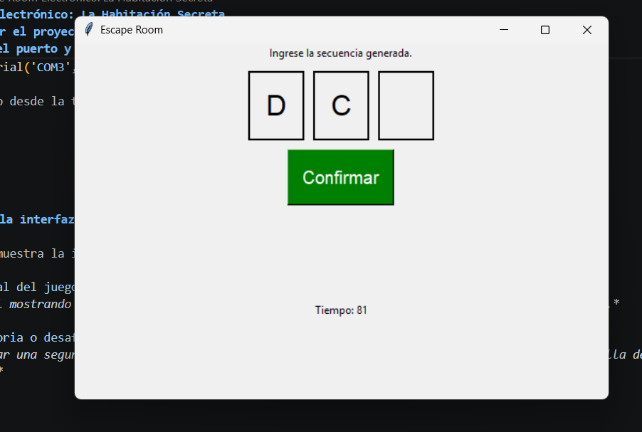
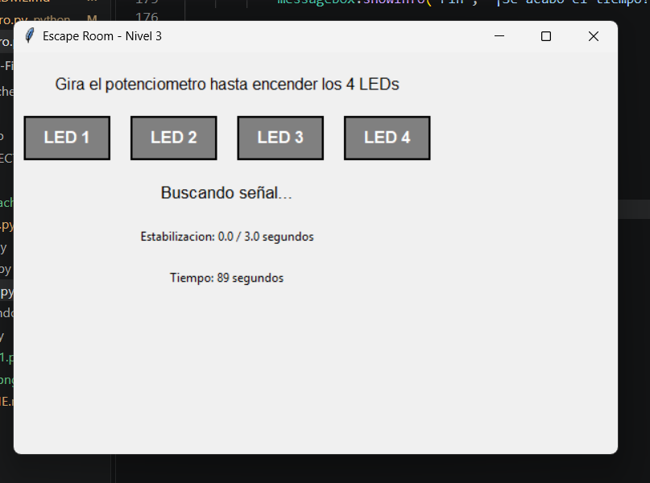
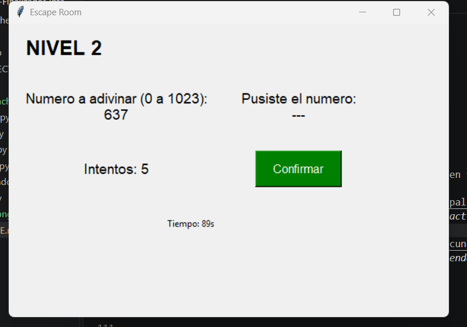

# 🔐 Escape Room Electrónico: La Habitación Secreta

**Proyecto Integrador - 4° C**

### 👥 Integrantes
* Purro Jeremias
* Santiago Arce
* Alfaro Tomas

---

## 📖 ¿De qué se trata el proyecto?

**Escape Room Electrónico** es un juego interactivo que combina hardware y software (físico y digital). El jugador debe resolver una serie de acertijos y desafíos utilizando componentes electrónicos conectados a una placa Arduino, mientras visualiza pistas, su progreso y el tiempo restante en una interfaz gráfica desarrollada en Python.

### 🎮 Cómo se juega y Reglas
El objetivo principal es escapar de "La Habitación Secreta" superando **3 desafíos consecutivos** antes de que el cronómetro llegue a cero:

1. **Desafío 1 - La combinación secreta:** El jugador debe descubrir e ingresar un código de 3 dígitos utilizando los botones físicos, ayudándose de las pistas que aparecen en pantalla.
2. **Desafío 2 - Ajustar el valor:** El juagador debe ajustar el valor del potenciometro para llegar al indicado y ganar.
3. **Desafío 3 - Ajustar el valor:** Debe ajustar el valor del potenciometro pero viendo los leds que se van encendiendo a medida que se acerca mas

* **🏆 Cómo se gana:** Completando los 3 desafíos antes de que se agote el tiempo límite (3 minutos) y sin perder todas las vidas/intentos.
* **💀 Cómo se pierde:** Si el cronómetro llega a `00:00` o si el jugador agota sus **3 intentos restantes** al equivocarse en los desafíos. *(Nota: El jugador cuenta con hasta 2 pistas para ayudarse).*

---

## 🛠️ Componentes usados y Conexiones (Pinout)

Para armar el circuito en la protoboard se utilizaron los siguientes componentes conectados a un **Arduino Uno**:

| Componente | Tipo | Cantidad | Pin en Arduino | Función en el juego |
| :--- | :--- | :---: | :---: | :--- |
| **Botón 1** | Sensor (Entrada Digital) | 1 | `Pin [COMPLETAR, ej: 2]` | Ingreso de código / Respuesta 1 |
| **Botón 2** | Sensor (Entrada Digital) | 1 | `Pin [COMPLETAR, ej: 3]` | Ingreso de código / Respuesta 2 |
| **Botón 3** | Sensor (Entrada Digital) | 1 | `Pin [COMPLETAR, ej: 4]` | Ingreso de código / Respuesta 3 |
| **Botón 4** | Sensor (Entrada Digital) | 1 | `Pin [COMPLETAR, ej: 5]` | Ingreso de código / Confirmar / Pista |
| **Potenciómetro** | Sensor (Entrada Analógica) | 1 | `Pin [COMPLETAR, ej: A0]` | Ajuste de valor en el Desafío 3 |
| **LED 1 (Rojo/Azul/etc.)** | Actuador (Salida Digital) | 1 | `Pin [COMPLETAR, ej: 8]` | Secuencia de luces / Indicador de error |
| **LED 2 (Verde/Amarillo/etc.)** | Actuador (Salida Digital) | 1 | `Pin [COMPLETAR, ej: 9]` | Secuencia de luces / Indicador de acierto |
| **LED 3** | Actuador (Salida Digital) | 1 | `Pin [COMPLETAR, ej: 10]` | Secuencia de luces |
| **Buzzer** | Actuador (Salida Digital/PWM) | 1 | `Pin [COMPLETAR, ej: 11]` | Efectos de sonido (acierto, error, alarma) |
| **Resistencias** | Pasivo | Varias | `GND / 5V` | Pull-down/Pull-up para botones y protección de LEDs |

*(Nota: Recordar conectar los rieles de `5V` y `GND` del Arduino a la protoboard).*

---

## 🔌 Cómo funciona la comunicación (Arduino ↔ Python)

El sistema utiliza **comunicación serial bidireccional** a través del cable USB a una velocidad de **`9600 baudios`** (ajustar si usaron `115200`).

### 📤 De Arduino hacia Python (Lectura de sensores)
Arduino lee constantemente el estado de los componentes físicos y envía mensajes de texto (strings) por el puerto serie cuando ocurre un evento:
* **Pulsación de botones:** Envía un identificador cuando se presiona un botón (ej. `"BTN:1"`, `"BTN:2"`, `"BTN:3"`, `"BTN:4"`).
* **Lectura del potenciómetro:** Envía el valor analógico mapeado (ej. `"POT:512"` o un rango de `0` a `100`) durante el desafío correspondiente.

### 📥 De Python hacia Arduino (Control de actuadores)
Python procesa la lógica del juego, valida las respuestas y envía comandos simples a Arduino para dar retroalimentación física al jugador:
* **Control de LEDs:** Envía órdenes para encender, apagar o hacer parpadear luces específicas (ej. `"LED1:ON"`, `"LED_WIN"`, `"SEC:1-3-2"`).
* **Control del Buzzer:** Envía señales para emitir distintos tonos según el estado del juego (ej. `"SND:OK"` para acierto, `"SND:ERR"` para error, `"SND:WIN"` al ganar).

---

## 🚀 Cómo ejecutar el proyecto

Seguí estos pasos para poner en marcha el juego desde cero:

### 1. Cargar el código en el Arduino
1. Conectá la placa **Arduino Uno** a la computadora mediante el cable USB.
2. Abrí el programa **Arduino IDE**.
3. Abrí el archivo del código fuente de Arduino (ej. `arduino/escape_room.ino`).
4. En el menú superior, andá a **Herramientas > Placa** y seleccioná **Arduino Uno**.
5. Andá a **Herramientas > Puerto** y seleccioná el puerto COM correspondiente (ej. `COM3` en Windows o `/dev/ttyUSB0` en Linux). *Anotá este puerto, lo vas a necesitar.*
6. Hacé clic en el botón **Subir** (la flecha hacia la derecha) y esperá a que aparezca el mensaje *"Subido"*. **Cerrá el Monitor Serie** si lo tenés abierto para no bloquear el puerto.

### 2. Instalar las librerías de Python
Asegurate de tener instalado **Python 3.x**. El proyecto utiliza `Tkinter` (que viene preinstalado con Python) y `pyserial` para la comunicación con la placa.

Abrí una terminal o consola en la carpeta del proyecto y ejecutá:
```bash
pip install pyserial
```
*(Si utilizaste otras librerías como `pygame` para sonidos o `Pillow` para imágenes, agregalas aquí: `pip install pyserial pillow pygame`).*

### 3. Configurar el puerto y abrir el juego
1. Abrí el archivo principal de Python (ej. `main.py` o `interfaz.py`) con un editor de texto o IDE.
2. Buscá la línea donde se configura la conexión serial y asegurate de que coincida con el puerto de tu Arduino:
   ```python
   ser = serial.Serial('COM3', 9600)  
   ```
3. Ejecutá el juego desde la terminal:
   ```bash
   python main.py
   ```

---

## 📸 Capturas de la interfaz funcionando

A continuación se muestra la interfaz gráfica del juego en funcionamiento:







---

